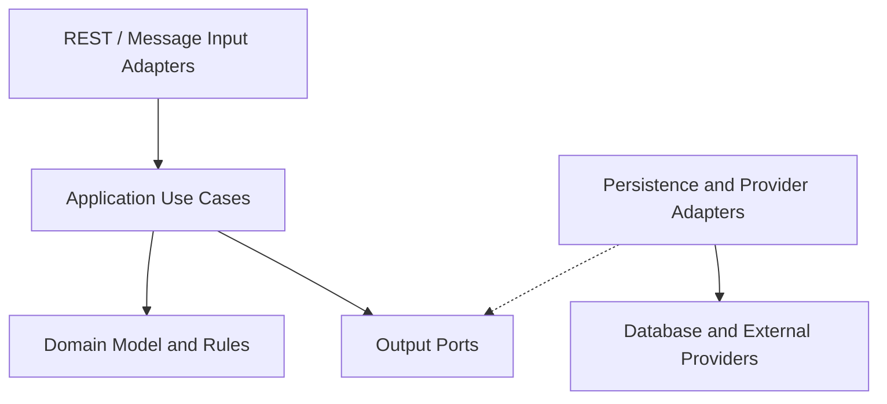

# Wallet — Project Overview

Wallet is a personal finance and asset-overview project designed to help users understand what they own, where their money is held, and how it moves across their financial accounts.

This repository is a public portfolio overview of the project. The detailed analysis, implementation work, and private project materials are maintained separately.

## Current Status

**Stage:** Analysis and Architecture Design

The project is being developed incrementally, starting with product discovery and domain understanding before implementation.

## Problem Space

Personal financial data is often scattered across banking applications, messages, savings records, and investment platforms. This makes it difficult to answer everyday questions such as:

- How much money do I have across my accounts?
- Which movements are expenses, income, or transfers between my own accounts?
- When was a balance last reported?
- Which information is confirmed, estimated, incomplete, or needs review?

Wallet aims to organize these observations in one understandable view while keeping each external provider as the authority for its own data.

## Product Direction

The first implementation phase focuses on:

- Bank accounts and cards
- Bank-message ingestion, initially through simulated messages
- Deposits and withdrawals
- Duplicate-message handling
- Bank-reported balance observations
- Internal transfers between a user's own accounts
- Transaction history and user-managed details

Future phases may include asset holdings, valuation, exchange integrations, cryptocurrency, gold, and other investment types.

## Delivery Journey

The project follows a deliberate, incremental path:

1. Project vision
2. Problem statement
3. Core business scenarios
4. Ubiquitous language
5. Event Storming
6. Business rules and invariants
7. Aggregates and domain model
8. Bounded contexts and context map
9. Use cases
10. Architecture decisions
11. Domain examples and tests
12. First executable vertical slice

## Architecture Direction

Wallet is planned as a modular monolith using:

- Java
- Spring Boot
- Maven
- Domain-Driven Design
- Clean Architecture
- Hexagonal Architecture
- Automated testing

The domain layer is intended to remain independent of web frameworks, persistence technologies, and external-provider formats.

## Development Approach

Work is organized through focused branches and pull requests. Each change is kept small, reviewable, and connected to a clear product or domain decision.

The emphasis is not only on writing code, but also on making business rules, assumptions, trade-offs, and future extension points explicit.

## Planned First Executable Slice

The first working slice will process a simulated deposit message end to end:

1. Receive a simulated bank message.
2. Validate the input.
3. Identify the target account.
4. Prevent duplicate transaction registration.
5. Store the transaction and reported balance observation.
6. Verify the behavior with automated tests.

## Repository Scope

This public repository intentionally contains only a high-level project overview.

It does not contain private implementation details, sensitive sample data, credentials, bank information, or internal working documents.
